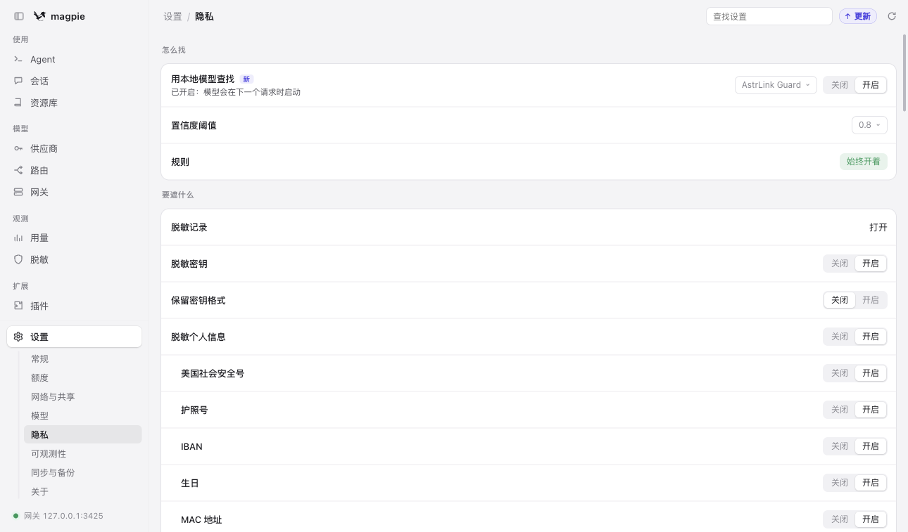
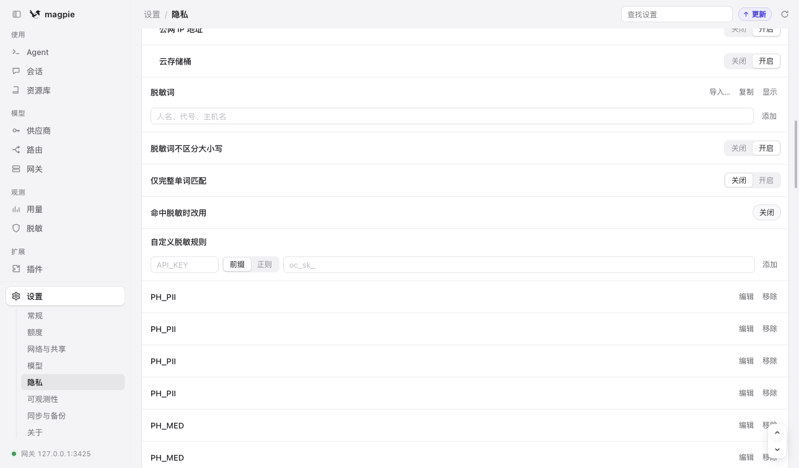
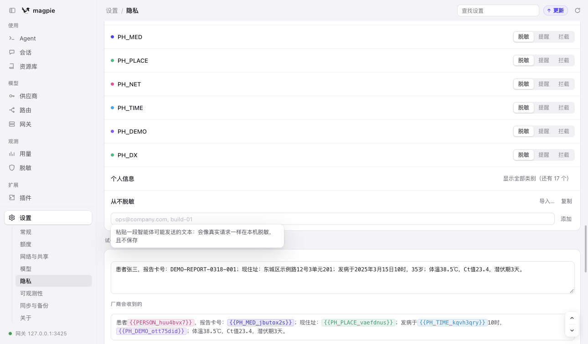
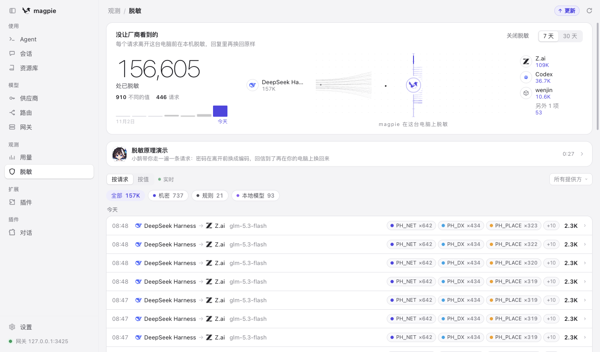

# 传染病资料脱敏规则库（Magpie 版）

**给公共卫生专业人员的使用说明** ｜ 版本 v2.1 ｜ 24 条规则 ｜ 7 类信息

---

## 这套东西是干什么的

你在电脑上让 AI 助手帮着写流调报告、整理监测数据、分析聚集性疫情时，资料会从你的电脑发到模型公司。**这套规则库的作用是：在资料离开你的电脑之前，自动把姓名、身份证号、电话、住址、单位、报告卡号、病种名称等敏感内容替换成占位符**，比如：

| 你写的内容 | AI 公司实际收到的内容 |
|---|---|
| 患者张三，报告卡号：DEMO-REPORT-0318-001 | 患者 `{{PERSON_huu4bvx7}}`，报告卡号：`{{PH_MED_jbutox2s}}` |
| 现住址：东城区示例路12号3单元201 | 现住址：`{{PH_PLACE_vaefdnus}}` |
| 发病于2025年3月15日10时，35岁 | 发病于 `{{PH_TIME_kqh3qry}}`，`{{PH_DEMO_ott75did}}` |
| 体温38.5℃，Ct值23.4，潜伏期3天 | 体温38.5℃，Ct值23.4，潜伏期3天（**保留**） |

AI 回复时，占位符会自动换回真实内容，所以你看到的报告仍是完整可用的。

**重要理解**：这是"发出去之前挡一道"，不是把数据变成完全匿名。资料里如果还留着罕见病种+小地方+精确时间这类组合，仍可能被认出是谁。**能不能把某份资料发给外部 AI，最终要按你单位的数据管理规定判断。**

---

## 准备工作（约 15 分钟）

你需要的：一台能装软件的电脑（Windows 10/11 或 macOS）、管理员权限（Windows 装 Python 时用）。

---

## 第 1 步：安装 Magpie

### macOS
1. 打开 <https://usemagpie.ai/download>，下载 macOS 版。
2. 把 Magpie 拖进"应用程序"文件夹，打开它。
3. 第一次打开会提示"来自互联网下载的 App"，点"打开"。
4. 屏幕右上角菜单栏出现一只喜鹊图标，说明装好了。

### Windows
1. 打开 <https://usemagpie.ai/download>，下载 Windows 版（.exe 安装包）。
2. 双击安装，一路"下一步"。
3. 装好后，屏幕右下角托盘区出现喜鹊图标（可能要点小箭头展开才能看到）。

> **验证**：点图标能看到一个面板，列出你电脑上的 AI 工具，就说明成功了。

---

## 第 2 步：确认"脱敏"总开关是开的

点菜单栏/托盘区的喜鹊图标 → **设置** → 左侧选 **隐私**。

对照下图检查，**这三项必须是这个状态**：



| 设置项 | 应该是 |
|---|---|
| **用本地模型查找** | 显示 `AstrLink Guard`，且是"已开启" |
| **规则** | 显示"始终开着"（灰色，不用管） |
| **脱敏密钥** | **开启** |
| **脱敏个人信息** | **开启** |

如果"用本地模型查找"还没开，点右边的 **开启**。第一次会下载约 39 MB 的模型，等它显示"已开启：模型会在下一个请求时启动"即可。

> **为什么必须开"脱敏密钥"？** 我们自己加的 24 条规则是挂在"脱敏密钥"这个开关下面的，关了它，规则也不工作。

---

## 第 3 步：加入 24 条规则

有两条路，**推荐 Mac 用户用方法 A，Windows 用户用方法 B**。两种效果完全一样。

### 方法 A：脚本自动合并（Mac，推荐）

打开"终端"（启动台搜索"终端"），整段复制粘贴回车：

```bash
# 1. 先退出 Magpie（菜单栏图标 → 退出）
# 2. 进入规则库文件夹（把路径换成你解压后的真实位置）
cd ~/Downloads/magpie-public-health

# 3. 生成合并后的配置（不会动你原来的配置）
python3 merge_settings.py \
  --settings "$HOME/.config/magpie/settings.json" \
  --output "$HOME/.config/magpie/settings.new.json"

# 4. 备份原配置并替换
cd ~/.config/magpie
mv settings.json settings.backup.json
mv settings.new.json settings.json

# 5. 重新打开 Magpie
open -a Magpie
```

### 方法 B：界面逐条添加（Windows / 不想用命令行）

1. 用记事本打开规则库文件夹里的 `strict-settings.patch.json`。
2. 找到 `"redactRules"` 这一段，里面每条规则都有 `"kind"` 和 `"regex"` 两个值。
3. 在 Magpie 里 **设置 → 隐私 → 自定义脱敏规则**，按下面这样一条一条加：



| 界面上的框 | 填什么 |
|---|---|
| 左边的类型名框（图中 `API_KEY` 位置） | 规则里的 `kind`，比如 `PH_PII` |
| 中间选 **正则** | （点一下"正则"） |
| 右边的长框 | 规则里的 `regex` 内容 |

**三个常见错误**：
- ❌ 把双引号也复制进去 → 只复制引号**里面**的内容
- ❌ 选了"前缀" → 必须选"正则"
- ❌ 类型名写成小写 `ph_pii` → 必须大写

24 条规则比较长，加的时候耐心点；每加完一条，列表里会出现一行，可以点"编辑"检查。

> **Windows 用户注意**：如果觉得 24 条太多，可以只加最关键的前 8 条（`PH_PII` 姓名证件电话、`PH_MED` 业务编号、`PH_PLACE` 地址单位、`PH_TIME` 日期时间、`PH_DX` 病种），其余以后补。但**至少要加这 5 类**，否则脱敏效果会明显不足。

### 怎么确认加成功了

回到 **设置 → 隐私** 往下的"自定义脱敏规则"列表，应该能看到 `PH_PII`、`PH_MED`、`PH_PLACE`、`PH_TIME`、`PH_DEMO`、`PH_NET`、`PH_DX` 这些名字，每个后面有"编辑 / 移除"。**看到它们 = 成功。**

---

## 第 4 步：补充你自己的"脱敏词"（很重要）

规则只能认格式（号码、日期、地址结构），**认不出你当地的学校和医院名字**。这一步必须你自己做。

在 **设置 → 隐私 → 脱敏词** 那里，把你工作里真实出现的名字一个个加进去，每行一个：

```
东城区实验小学
示例市第三人民医院
XX县疾控中心
XX花园小区
XX食品有限公司
```

> **不要**把"姓名""学校""医院""疾控""确诊"这种通用词加进去——那会把所有这类词都遮掉，AI 反而看不懂你在写什么。

**建议**：每换一个项目/地区，回来更新一次这个列表。

---

## 第 5 步：用"试一试"验收（每次配置完必做）

同一页面往下滚，找到 **试一试** 输入框。粘贴下面这段**虚构**文字（不要用真实病例）：

```
患者张三，报告卡号：DEMO-REPORT-0318-001；现住址：东城区示例路12号3单元201；
发病于2025年3月15日10时，35岁；体温38.5℃，Ct值23.4，潜伏期3天。
```

下面"**厂商会收到的**"一栏应该长这样：



**合格标准**：
- ✅ 姓名、卡号、住址、日期、年龄 → 变成 `{{...}}` 占位符
- ✅ 体温、Ct值、潜伏期、症状 → 原样保留（这些是分析要用的）
- ❌ 如果姓名、地址还是原样显示 → 没配好，回到第 2、3 步检查

> 这个框里的内容不会被保存，可以放心测试。

---

## 第 6 步：日常使用和检查

### 让 AI 工具走 Magpie

Magpie 的 **Agent** 页面会列出你电脑上的 AI 工具。点一下，把它切换成"经过 Magpie"，之后它的所有请求都会先过脱敏。

### 看看到底遮了什么

左侧 **观测 → 脱敏**，能看到每次请求遮了哪些内容、遮了多少：



这张图里 `PH_NET ×642`、`PH_DX ×434` 就是实际遮住的数量。**平时不用天天看，但处理完一批敏感资料后建议扫一眼**，确认规则确实在工作。

---

## 给 AI 助手配置提示词（推荐做）

脱敏开启后，AI 看到的是 `{{PH_PII_xxxx}}` 这样的占位符。绝大多数情况 AI 能正确当"某个真实值"来用，但为了稳妥，建议给 AI 助手一段固定提示词，让它明白"这些占位符就是真实数据，别猜、别改、别问"。

### 第 1 步：把提示词保存为文件

新建一个纯文本文件（记事本/文本编辑都可以），命名为 `gongwei-prompt.txt`，粘贴以下内容：

```text
你正在协助公共卫生专业人员处理传染病防治工作。你看到的文本中，凡形如 {{API_KEY_xxxx}}、{{PH_PII_xxxx}}、{{PERSON_xxxx}}、{{PH_PLACE_xxxx}}、{{PH_TIME_xxxx}}、{{PH_MED_xxxx}}、{{PH_DEMO_xxxx}}、{{PH_DX_xxxx}}、{{EMAIL_xxxx}} 的标记，都是经过隐私脱敏的占位符。请遵守：

1. 占位符代表真实存在的值：{{PERSON_xxxx}} 就是"某个人名"，{{PH_PLACE_xxxx}} 就是"某个真实地址"，处理时把它当作原值使用，不要当作错误或乱码。
2. 不要猜测、追问或尝试还原占位符背后的真实姓名、证件号、电话、住址。即使任务看起来需要，也用占位符继续。
3. 写报告、表格、代码时保持占位符原样：不拆分、不缩写、不重新排版（{{PH_PII_ab12cd34}} 不能写成 {{PH_PII...}}）。
4. 输出涉及个案时，沿用材料里已有的编号（如 P001、P002）；材料里没有编号时，新建"P001"式编号，不要留"姓名：____"这样的空位。
5. 病种名称可能已被遮蔽。需要围绕具体疾病分析时，说明"病种信息已脱敏"，并根据可用的流行病学特征（传播途径、症状、潜伏期、季节性）进行推理，不要臆断病名。
6. 日期可能以相对形式出现（D0、D1）。保持相对口径计算时间间隔，不要换算成绝对日期。
7. 不要把占位符替换成编造的示例值（如"张三"）；需要示例时明确标注"虚构示例"。

你的产出会自动还原占位符后交回给使用者，你不需要做任何还原动作。
```

### 第 2 步：写入 Magpie，自动分发到所有 AI 助手

```bash
# macOS / Linux
magpie library instructions set ~/Downloads/gongwei-prompt.txt

# Windows（PowerShell，路径按实际位置调整）
magpie library instructions set "$env:USERPROFILE\Downloads\gongwei-prompt.txt"
```

命令执行完还没结束——**默认不会发给任何助手**，要再指定给谁用：

```bash
# 指定给 Claude Code 和 Codex（装了哪个写哪个，逗号分隔）
magpie library instructions agents claude,codex
```

看到 `✓ written into claude, codex` 就成功了（助手原有的说明内容会自动备份，路径会显示在屏幕上）。之后：

- 查看是否生效：`magpie library instructions`（应显示"→ claude, codex"而不是"no agent"）
- 改了内容重新分发：重新执行 `set` 和 `agents` 两条命令即可
- 发给所有已连接助手：`magpie library instructions agents` 后面把名字都写上

也可以在 Magpie 窗口左侧的 **资源库** 页面里粘贴和勾选助手，效果相同。

### 常用任务提示词模板（配合上面的全局提示词使用）

**流调报告撰写**——开一个对话时粘贴：

```text
请根据我提供的脱敏调查资料，按以下结构撰写流行病学个案调查报告：一、基本信息（用编号）二、发病与就诊经过 三、流行病学史 四、实验室检测 五、初步判断。要求：时间统一用相对口径（D0=发病日）；保持所有 {{...}} 占位符原样；不确定的信息标注"待核实"；不要编造占位符以外的身份细节。
```

**聚集性疫情描述分析**：

```text
以下是某起聚集性疫情的脱敏病例一览表。请做描述性分析：1）按发病日期绘制流行曲线的文字描述（用D0起算）；2）人群分布（年龄组、性别构成，若性别被遮蔽则说明）；3）场所与接触关系归纳；4）提示可能的暴露关联与不确定性。所有输出用编号指代病例，不要请求真实身份信息。
```

**监测数据统计**：

```text
我给你脱敏后的周监测数据。请统计：报告数环比变化、各监测点检出构成比、发病到报告的时间间隔分布（按相对天数）。输出一份可直接粘贴进周报的文字与表格；表格里出现占位符时保持原样；数值计算基于可见数据，口径不明处列出待确认清单。
```

### 提示词不是脱敏的一部分

要分清两层保护：**规则库负责"拦"（把敏感内容挡在发出之前），提示词负责"教"（让 AI 正确对待已被遮蔽的内容）**。提示词挡不住任何信息，也不能替代规则；反过来，就算不配提示词，脱敏照常生效。如果 AI 反过来问你真实姓名、住址，不要提供——那是它在试图还原占位符。

## 常见问题

**Q：Windows 上配置文件在哪？**
`C:\Users\你的用户名\.config\magpie\settings.json`。在文件管理器地址栏输入 `%USERPROFILE%\.config\magpie` 可直接打开。

**Q：脚本报错"超过 32 条规则"？**
Magpie 最多支持 32 条自定义规则。说明你之前加过别的规则，需要先在界面里删掉一些旧的，再重新运行脚本。

**Q：为什么"男/女"没被遮住？**
Magpie 的自定义规则会忽略少于 4 个字节的命中值，单个汉字（如"男""女""汉"）遮不住。这类字段建议在本地处理时直接删掉或改成"性别A/性别B"。

**Q：Excel/CSV 表格能直接贴吗？**
**不能指望规则自动识别表格列**。带表头的 CSV 里，"姓名"列下面的数据行没有"姓名："这样的标签，规则认不出来。请先把表格转成"字段：值"的形式，或者先在本地把姓名列删掉/替换成编号。

**Q：截图、扫描的 PDF 里的字能遮吗？**
**不能**。这些规则只处理文字，图片里的文字（包括截图里的姓名）不在保护范围内。含个人信息的截图不要直接发给 AI。

**Q：病种名称遮住了，AI 就没法帮我分析这个病了？**
确实有这个代价。如果你这次的任务就是要分析某个具体病种，可以临时在界面上把 `PH_DX` 那几条规则点"移除"（用完再加回来），或者只发脱敏后的汇总数据。

**Q：配置错了怎么恢复？**
用第 3 步方法 A 的话，原配置备份在同目录的 `settings.backup.json`，把它改回 `settings.json` 即可。Windows 界面配置的话，逐条点"移除"。

---

## 这套规则的边界（请务必了解）

| 能做 | 不能做 |
|---|---|
| 挡住姓名、证件号、电话、住址、单位、卡号等**格式明确**的内容 | 不能保证完全匿名——罕见病+小地区+精确时间组合仍可能识别个人 |
| 42种法定传染病病名全覆盖（2026年4月1日新版目录，含基孔肯雅热、发热伴血小板减少综合征；人感染H7N9禽流感按"人感染新亚型流感"目录名及H7N9/禽流感等写法匹配） | 非法定病种（如新冠肺炎）和罕见病名可能漏 |
| 挡住日期、钟点、年龄 | 不能自动做"日期平移"或"年龄分组"，需要你先在本地处理 |
| 处理文字 | 不处理图片、扫描件、附件二进制内容 |
| 减少模型公司看到的内容 | 不改变"该不该发出去"这个判断——那要按单位规定来 |

**一句话**：它能显著降低"无意中把患者信息发给 AI 公司"的风险，但不能替代数据分级管理和审批流程。

---

## 附录：给单位 IT 支持人员

- 规则库源码与更新：<https://usemagpie.ai/download>
- 技术验证：24 条规则全部通过 RE2 语法与 Magpie 长度限制（≤32 条、每条 ≤300 字节）；59 个正例（含42种病名抽验）与 4 段应保留文本回归通过
- 合并脚本 `merge_settings.py` 只生成新文件、不修改原配置，输出权限 0600
- 规则类型名受 Magpie 限制只能用大写英文（见 `规则明细.md`）
- 上游依据：[Magpie 脱敏文档](https://usemagpie.ai/docs

---

*本规则库为社区整理，与 Magpie 官方无关。截图取自 Magpie 0.1.31xx 中文界面，不同版本措辞可能略有差异。*
